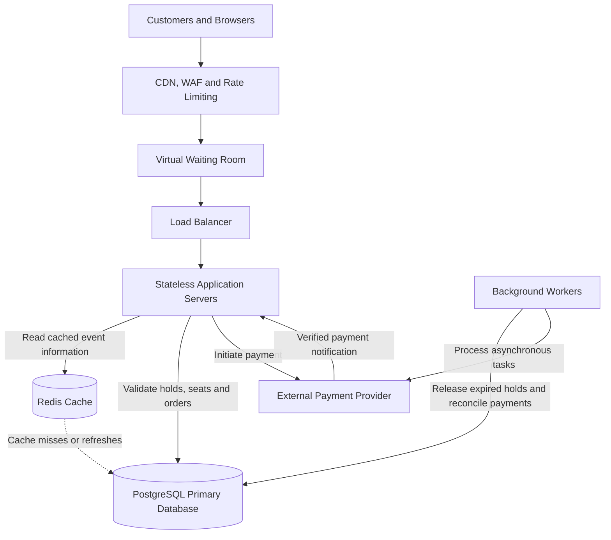

# TicketHub: Event Ticketing System Design

## 1. Requirements

### 1.1 Functional Requirements

TicketHub is a website that allows users to discover events, reserve seats, purchase tickets, and view their confirmed bookings.

The system must support the following functional requirements:

* **FR1 — User Accounts:** Users can register, log in, and securely access their accounts.
* **FR2 — Browse Events:** Users can browse, search, and view details of available concerts and other events.
* **FR3 — View Seats:** Users can view the seating layout and the availability of individual seats for an event.
* **FR4 — Hold Seats:** Users can temporarily hold available seats while completing checkout. Each hold has an expiration time.
* **FR5 — Purchase Tickets:** Users can pay for their held seats and receive confirmation when payment succeeds.
* **FR6 — View Tickets:** Users can view their confirmed orders and ticket details.
* **FR7 — Expired Holds:** The system automatically releases seats whose holds have expired without a successful purchase.

### 1.2 Non-Functional Requirements

**Performance:** Event listings should load within 2 seconds under normal operating conditions. Seat availability and checkout requests should respond quickly without sacrificing correctness.

**Scalability:** The system must support 2 million registered users, normal daily traffic, and sudden traffic spikes during popular concert sales.

**Correctness and Data Integrity:** A seat must not be sold to more than one customer. Seat reservations, order creation, and payment confirmation must maintain consistent records, even when requests fail or are repeated.

**Fairness:** During high-demand sales, the system should use a controlled waiting queue, rate limits, and a consistent allocation policy. These measures should reduce automated abuse and give customers a fair opportunity to purchase tickets.

**Reliability:** The system must preserve confirmed orders and provide a safe way to reconcile payment results when payment services or network connections fail.

**Security and Privacy:** Users must authenticate before purchasing tickets or viewing private orders. The system must enforce access controls, protect sensitive information, and use secure communication.

**Availability:** The system should remain usable during sudden increases in traffic. If some requests must be delayed or rejected, it should communicate this clearly rather than risk selling the same seat twice.
## 2. Traffic Estimates

### 2.1 Normal Traffic

TicketHub has 2 million registered users. On a normal day, approximately 50,000 people visit the website, and each visitor views an average of 10 pages.

**Daily page views:**

50,000 visitors × 10 pages = 500,000 page views per day.

**Average page requests per second:**

500,000 ÷ 86,400 seconds per day ≈ 5.79 page requests per second.

Therefore, the system handles approximately 6 page requests per second on average, although actual traffic will vary throughout the day.

TicketHub sells approximately 5,000 tickets per normal day.

**Average ticket sales per second:**

5,000 ÷ 86,400 ≈ 0.058 tickets per second.

This is equivalent to approximately 208 ticket sales per hour on average.

### 2.2 Popular Concert Sale

When a popular concert goes on sale, 200,000 people attempt to buy tickets within the first 10 minutes. The concert has only 20,000 available seats.

**Purchase attempts per second:**

10 minutes × 60 seconds = 600 seconds.

200,000 purchase attempts ÷ 600 seconds ≈ 333.33 purchase attempts per second.

The system must therefore accommodate an average of approximately 333 purchase attempts per second during this period. The actual peak rate could be higher if requests arrive unevenly.

**Demand-to-supply ratio:**

200,000 potential buyers ÷ 20,000 seats = 10 potential buyers per seat.

If each successful customer purchases one seat, only 20,000 of the 200,000 potential buyers can obtain tickets. This represents 10% of the potential buyers.

The available information does not specify page views during the concert sale, so the exact page request rate during this period cannot be calculated.

### 2.3 Comparison and Scaling Strategy

Normal traffic averages approximately 5.79 page requests per second, while the popular concert sale produces approximately 333 purchase attempts per second. These figures measure different types of requests, but they illustrate the need to handle a sudden increase in checkout demand.

TicketHub will use a waiting queue to regulate access during major sales, a load balancer to distribute requests across application servers, and caching to reduce unnecessary database queries for event information.

Rate limiting will help reduce excessive requests. The database will remain responsible for enforcing seat availability and preventing double-booking.

The system will be designed to scale application capacity horizontally. Capacity planning and load testing will be needed to determine the number of servers and database resources required for the actual peak workload.
## 3. API Design

TicketHub will expose a REST-style HTTP API. JSON will be used for request and response bodies. Endpoints that access private orders, holds, or tickets will require authentication and authorization.

### 3.1 API Endpoints

| Method | Endpoint                        | Purpose                                                                      |
| ------ | ------------------------------- | ---------------------------------------------------------------------------- |
| GET    | `/api/events`                   | Browse and search available events.                                          |
| GET    | `/api/events/{eventId}`         | Retrieve details for a specific event.                                       |
| GET    | `/api/events/{eventId}/seats`   | Retrieve the seating layout and seat availability.                           |
| POST   | `/api/holds`                    | Temporarily hold available seats for the authenticated user.                 |
| POST   | `/api/orders/{orderId}/payment` | Initiate payment for an order.                                               |
| GET    | `/api/tickets`                  | Retrieve tickets belonging to the authenticated user.                        |
| GET    | `/api/orders/{orderId}`         | Retrieve the status and details of an order owned by the authenticated user. |

### 3.2 Example Requests and Responses

**Browse events**

Request:

`GET /api/events?search=concert`

The response contains matching events, including their identifiers, names, venues, dates, and ticket information.

**View seats**

Request:

`GET /api/events/101/seats`

Example response:

```json
{
  "eventId": 101,
  "seats": [
    {"seatId": 501, "label": "A1", "status": "AVAILABLE"},
    {"seatId": 502, "label": "A2", "status": "HELD"},
    {"seatId": 503, "label": "A3", "status": "SOLD"}
  ]
}
```

Seat availability displayed to a customer may become outdated. The server must verify the current database state before granting a hold.

**Hold seats**

Request:

`POST /api/holds`

Example request body:

```json
{
  "eventId": 101,
  "seatIds": [501]
}
```

If the seat is available, the server creates a temporary hold and returns a hold identifier and expiration time. If the seat is already held or sold, the server rejects the request.

**Initiate payment**

Request:

`POST /api/orders/9001/payment`

The server initiates payment for the associated order through a payment provider. A purchase is confirmed only after the payment result has been verified and the order and seat records have been updated successfully.

**View purchased tickets**

Request:

`GET /api/tickets`

The server returns confirmed tickets belonging to the authenticated user. It must not expose another user's private ticket information.

**View an order**

Request:

`GET /api/orders/9001`

The response reports the order status, such as PENDING_PAYMENT, CONFIRMED, FAILED, or EXPIRED, subject to authorization checks.

### 3.3 API Reliability and Error Handling

The API will use appropriate HTTP status codes:

* `200 OK` for successful retrievals.
* `201 Created` when a new hold or order is successfully created.
* `400 Bad Request` for invalid request data.
* `401 Unauthorized` when authentication is missing or invalid.
* `403 Forbidden` when a user lacks permission to access a resource.
* `404 Not Found` when a requested resource does not exist.
* `409 Conflict` when a requested seat cannot be held because it is no longer available.
* `429 Too Many Requests` when a client exceeds its rate limit.
* `503 Service Unavailable` when the system temporarily cannot accept a request.

Payment requests will use idempotency keys so that retries do not unintentionally create duplicate payment operations. Payment-provider notifications will also be verified and processed idempotently.

Seat availability will always be checked against authoritative server-side state. Client-side seat displays and cached information will never be treated as proof that a seat can be purchased.
## 4. Data Model

TicketHub will use PostgreSQL, a relational database, to store users, events, seats, orders, and purchased ticket items.

Primary keys uniquely identify records. Foreign keys connect related records and help maintain referential integrity.

### 4.1 Database Tables

#### Table 1: users

Stores registered customer accounts.

| Column        | Type                         | Description             |
| ------------- | ---------------------------- | ----------------------- |
| id            | BIGINT PRIMARY KEY           | Unique user identifier. |
| email         | VARCHAR(255) UNIQUE NOT NULL | User's email address.   |
| password_hash | TEXT NOT NULL                | Secure password hash.   |
| created_at    | TIMESTAMPTZ NOT NULL         | Account creation time.  |

#### Table 2: events

Stores concert and event information.

| Column    | Type                  | Description                                   |
| --------- | --------------------- | --------------------------------------------- |
| id        | BIGINT PRIMARY KEY    | Unique event identifier.                      |
| name      | VARCHAR(255) NOT NULL | Event name.                                   |
| venue     | VARCHAR(255) NOT NULL | Event venue.                                  |
| starts_at | TIMESTAMPTZ NOT NULL  | Event start time.                             |
| status    | VARCHAR(30) NOT NULL  | Event status, such as SCHEDULED or CANCELLED. |

#### Table 3: seats

Stores the seats available for each event.

| Column          | Type                                  | Description                           |
| --------------- | ------------------------------------- | ------------------------------------- |
| id              | BIGINT PRIMARY KEY                    | Unique seat identifier.               |
| event_id        | BIGINT NOT NULL REFERENCES events(id) | Event to which the seat belongs.      |
| seat_label      | VARCHAR(30) NOT NULL                  | Human-readable label, such as A1.     |
| price           | NUMERIC(10,2) NOT NULL                | Ticket price for the seat.            |
| status          | VARCHAR(20) NOT NULL                  | AVAILABLE, HELD, or SOLD.             |
| hold_expires_at | TIMESTAMPTZ NULL                      | Expiration time for a temporary hold. |
| held_by_user_id | BIGINT NULL REFERENCES users(id)      | User who currently holds the seat.    |

The combination of `event_id` and `seat_label` must be unique so that an event cannot contain duplicate seat labels.

#### Table 4: orders

Stores customer orders and their payment status.

| Column            | Type                                 | Description                                                 |
| ----------------- | ------------------------------------ | ----------------------------------------------------------- |
| id                | BIGINT PRIMARY KEY                   | Unique order identifier.                                    |
| user_id           | BIGINT NOT NULL REFERENCES users(id) | Customer who placed the order.                              |
| status            | VARCHAR(30) NOT NULL                 | PENDING_PAYMENT, CONFIRMED, FAILED, or EXPIRED.             |
| total_amount      | NUMERIC(10,2) NOT NULL               | Total order amount.                                         |
| payment_reference | VARCHAR(255) NULL                    | Reference returned by the payment provider.                 |
| idempotency_key   | VARCHAR(255) NOT NULL UNIQUE         | Prevents duplicate order creation for the same request key. |
| created_at        | TIMESTAMPTZ NOT NULL                 | Order creation time.                                        |

#### Table 5: order_items

Connects orders to the individual seats being purchased.

| Column       | Type                                  | Description                                |
| ------------ | ------------------------------------- | ------------------------------------------ |
| id           | BIGINT PRIMARY KEY                    | Unique order-item identifier.              |
| order_id     | BIGINT NOT NULL REFERENCES orders(id) | Order containing the item.                 |
| seat_id      | BIGINT NOT NULL REFERENCES seats(id)  | Seat being purchased.                      |
| ticket_price | NUMERIC(10,2) NOT NULL                | Price recorded when the order was created. |

For assigned-seat events, a database constraint or partial unique index must prevent the same seat from appearing in multiple confirmed order items.

### 4.2 Table Relationships

* **Users to orders:** One user can have many orders. Each order belongs to one user.
* **Events to seats:** One event has many seats. Each seat belongs to one event.
* **Orders to order_items:** One order can contain multiple order items. Each item belongs to one order.
* **Seats to order_items:** Each order item refers to one seat. A seat must not appear in more than one confirmed purchase.
* **Users to seats:** The optional `held_by_user_id` references the user holding a seat temporarily.

### 4.3 Preventing Double-Booking

TicketHub must not rely only on the application checking whether a seat is available.

When a user requests a hold, the application starts a database transaction and locks the requested seat records using PostgreSQL row-level locking. It verifies that each seat is available or that any previous hold has expired, then updates the seat status and expiration time before committing the transaction.

If another customer attempts to hold the same seat simultaneously, the second transaction must wait for the lock to be released and then check the updated seat state. It cannot successfully hold a seat that is already held by another customer.

The database will also enforce a uniqueness rule on confirmed seat purchases. For example, a partial unique index on `order_items(seat_id)` for items whose associated orders have status CONFIRMED can prevent the same seat from appearing in two confirmed orders.

Because PostgreSQL partial indexes cannot directly reference columns in another table, implementing this exact rule may require a separate seat-sale table or a carefully designed database constraint strategy. TicketHub can instead make the seat's `status` field authoritative and enforce the transition from HELD to SOLD within a transaction, with an appropriate uniqueness constraint on a dedicated confirmed-sales table.

Payment confirmation must verify that the seat hold remains valid and that the order has not already been confirmed. A successful payment notification must not automatically mark a seat as sold without these checks.

Expired holds will be released through a background worker. The worker must lock affected records and recheck their status and expiration time before changing HELD seats back to AVAILABLE, so it cannot accidentally release a seat that has already been sold.
## 5. System Architecture

### 5.1 Architecture Diagram

The following diagram illustrates the main components of TicketHub and how requests flow through the system.



### 5.2 Component Explanations

**1. Customers and Browsers**

Customers use the website to browse events, view seats, place orders, pay for tickets, and retrieve their purchased tickets.

**2. CDN, WAF, and Rate Limiting**

The CDN delivers static resources efficiently and reduces repeated requests to the application. The WAF helps filter malicious traffic, while rate limiting restricts excessive requests.

**3. Virtual Waiting Room**

During popular sales, customers enter a controlled waiting queue before reaching the purchasing process. The queue limits how many customers enter checkout at once and applies a published allocation policy to support fairness.

The waiting room must also handle expired queue sessions, reconnecting customers, and automated abuse.

**4. Load Balancer**

The load balancer distributes incoming application requests among healthy application server instances. This prevents a single application server from becoming the only point of processing capacity.

**5. Stateless Application Servers**

The application servers implement the API and business rules. They handle event browsing, seat holds, order creation, payment initiation, and ticket retrieval.

Because the servers are stateless where practical, more instances can be added during high-demand sales without moving customer sessions between servers.

**6. Redis Cache**

Redis stores frequently accessed, relatively stable event information and can support suitable temporary queue-related data. This reduces unnecessary reads from PostgreSQL.

Redis is not the authoritative source of seat availability. Every new hold and purchase must be validated against the database.

**7. PostgreSQL Primary Database**

PostgreSQL stores users, events, seats, orders, and order items. Transactions, row-level locks, and database constraints protect seat allocation and order consistency.

All successful seat holds and purchase confirmations must respect the authoritative database state.

**8. External Payment Provider**

The payment provider processes payments. TicketHub verifies payment results through authenticated provider notifications or trusted provider-side verification.

Repeated payment notifications must be processed idempotently so that retries do not create duplicate confirmations.

**9. Background Workers**

Background workers release expired holds, process asynchronous tasks, and reconcile uncertain payment outcomes. Before releasing a held seat, a worker must recheck the seat's current status and expiration time within a safe transaction.

### 5.3 Handling the Popular Concert Sale

TicketHub will use several coordinated strategies to handle the sudden increase in traffic:

* **Queue admission:** The virtual waiting room limits the rate at which customers reach checkout, protecting downstream services from an uncontrolled surge.
* **Horizontal scaling:** Additional application server instances can be started as demand increases.
* **Caching:** Frequently accessed event information can be served without repeatedly querying PostgreSQL.
* **Database protection:** The application limits unnecessary database work and uses transactions and row-level locking for seat reservations.
* **Controlled payment processing:** Payment initiation and asynchronous notifications are handled with timeouts, idempotency, and reconciliation to avoid duplicate processing.
* **Background processing:** Expired holds and other non-interactive tasks are handled by workers instead of being placed entirely on the customer's request path.
* **Monitoring:** Metrics and alerts track queue length, request latency, error rates, database connection usage, payment failures, and the number of remaining seats.

The system should be load-tested before a major sale to determine the required application capacity, database capacity, and safe checkout admission rate.

If demand exceeds capacity, the waiting room should delay customers or temporarily reject requests with clear retry instructions rather than overwhelm the database or compromise seat correctness.

## 6. Design Trade-offs

### 6.1 Virtual Waiting Room Versus Immediate Checkout

**Decision:** TicketHub will use a virtual waiting room during high-demand sales.

**Advantages:** The waiting room regulates checkout traffic, protects downstream services, and supports a consistent ticket-allocation policy.

**Disadvantages:** Customers may have to wait, and the queue adds operational complexity and another component that must remain reliable.

**Justification:** During a sale with 200,000 potential buyers, controlled admission is preferable to allowing an uncontrolled traffic surge to overwhelm the purchasing system.

### 6.2 PostgreSQL Consistency Versus Cached Availability

**Decision:** PostgreSQL will be the authoritative source for seat availability and purchase confirmation, while Redis will cache suitable event information.

**Advantages:** Database transactions and constraints protect seat allocation, while caching reduces repeated reads and improves response times for event browsing.

**Disadvantages:** PostgreSQL can become a bottleneck under heavy write traffic. Row-level locks may cause contention, and maintaining an efficient database requires careful indexing, connection management, and load testing.

**Justification:** Correctness is more important than serving potentially outdated seat availability. The system can tolerate a seat display being briefly stale, but it must never confirm two successful purchases for the same seat.

### 6.3 Temporary Holds Versus Immediate Purchase

**Decision:** Customers will receive a limited time to complete checkout after successfully holding seats.

**Advantages:** Temporary holds provide a predictable checkout window and prevent other customers from taking the seats during that period.

**Disadvantages:** Uncompleted holds temporarily reduce available inventory, and the system needs reliable expiration processing and payment reconciliation.

**Justification:** Temporary holds improve the checkout experience, but they must expire safely. Before releasing a seat, the system must check for an active hold, a confirmed purchase, and any unresolved payment result.
